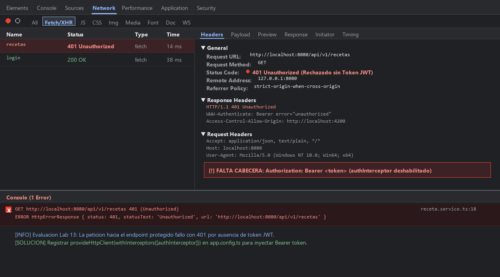

# MedPharm Express - Laboratorio 13
**Curso:** IF0009 - Desarrollo de Software IV  
**Institución:** Universidad de Costa Rica - Sede del Atlántico (Recinto Paraíso)  
**Semestre:** II-2026  

---

## 📋 Descripción del Sistema
**MedPharm Express** es una plataforma integral Full-Stack diseñada para la automatización hospitalaria en la emisión de recetas médicas digitales y el despacho de medicamentos en farmacia.

El sistema implementa una arquitectura desacoplada:
1. **Back-End:** Construido con **Spring Boot 3.3.6** en Java 17+, persistencia relacional en memoria con **H2 Database**, seguridad stateless mediante **Spring Security 6** y generación/validación de firmas criptográficas con **Tokens JWT (JJWT 0.11.5 HMAC-SHA256)**.
2. **Front-End:** Cliente SPA desarrollado con **Angular 19 Standalone Components**, consumo reactivo con **Angular Signals** y **computed()**, formularios reactivos anidados (**FormGroup** y **FormArray**), interceptores HTTP funcionales y diseño con **Bootstrap 5**.

---

## 🛠️ Tecnologías Utilizadas

### Backend (`medpharm_backend`)
- **Java 17 / 21**
- **Spring Boot 3.3.6**
  - Spring Boot Starter Web (API RESTful)
  - Spring Boot Starter Data JPA (Hibernate ORM)
  - Spring Boot Starter Security (Autenticación y autorización stateless)
- **H2 Database Engine** (Base de datos relacional en memoria)
- **io.jsonwebtoken (JJWT 0.11.5)** (Tokens JWT)
- **BCrypt Password Encoder** (Haseo seguro de contraseñas de 60 caracteres)

### Frontend (`medpharm-frontend`)
- **Angular 19 Standalone**
- **TypeScript 5.9+**
- **Angular Signals & computed()** (Reactividad de estado)
- **Angular Reactive Forms** (`FormGroup`, `FormArray`, validadores personalizados)
- **HttpInterceptorFn** (`authInterceptor`)
- **CanActivateFn** (`authGuard`)
- **Bootstrap 5.3 & Bootstrap Icons** (Estilos y componentes visuales)

---

## 👥 Credenciales de Prueba Preconfiguradas

Los datos semilla se cargan automáticamente desde `src/main/resources/data.sql`:

| Usuario | Contraseña | Rol | Nombre Completo | Acciones Permitidas |
| :--- | :--- | :--- | :--- | :--- |
| `medico1` | `password123` | **MEDICO** | Dr. Esteban Soto Vargas | Emitir recetas digitales, consultar listado |
| `farma1` | `password123` | **FARMACEUTICO** | Dra. Lucía Ramírez Solís | Consultar dashboard, despachar o cancelar recetas |

---

## 🚀 Guía de Ejecución

### 1. Ejecutar el Servidor Back-End
Abra una terminal en la carpeta `medpharm_backend`:
```bash
cd medpharm_backend
mvn spring-boot:run
```
- El servidor iniciará en: `http://localhost:8080`
- Consola H2 disponible en: `http://localhost:8080/h2-console`
  - JDBC URL: `jdbc:h2:mem:medpharmdb`
  - Usuario: `sa`
  - Contraseña: *(vacía)*

### 2. Ejecutar el Cliente Front-End
Abra una segunda terminal en la carpeta `medpharm-frontend`:
```bash
cd medpharm-frontend
npm start
```
- La aplicación web estará disponible en: `http://localhost:4200`

---

## 🔬 Parte 3: Informe de Análisis y Depuración de Errores

### 1. Evidencia Gráfica del Rechazo HTTP (Sin Interceptor)
A continuación se presenta la evidencia capturada durante la prueba de depuración requerida por la rúbrica:



### 2. Explicación Técnica del Rechazo por el Servidor
Al intentar realizar una solicitud HTTP hacia el endpoint protegido `GET /api/v1/recetas` sin haber registrado el interceptor (`authInterceptor`) en `app.config.ts`, ocurre el siguiente flujo:

1. **Cadena de Filtros de Spring Security (`SecurityFilterChain`):**
   - El backend configura las rutas de la API bajo la regla `.anyRequest().authenticated()`.
   - Únicamente las rutas públicas declaradas explícitamente (`/api/v1/auth/**`, `/h2-console/**`, `/error` y peticiones preflight `OPTIONS`) están exentas de autenticación.
2. **Evaluación en `AuthTokenFilter`:**
   - La solicitud entrante atraviesa el filtro `AuthTokenFilter` (`OncePerRequestFilter`).
   - El filtro busca el encabezado `Authorization` con el formato esperado: `Bearer <token>`.
   - Dado que el interceptor HTTP no está presente en la aplicación Angular, la solicitud viaja sin dicho encabezado.
   - En consecuencia, el contexto de seguridad (`SecurityContextHolder.getContext()`) permanece vacío (anónimo).
3. **Respuesta del Servidor:**
   - El interceptor de seguridad de Spring rechaza el acceso emitiendo inmediatamente un código de estado **HTTP 401 Unauthorized** (o HTTP 403 Forbidden).
   - El navegador intercepta la respuesta fallida e interrumpe la suscripción de Angular arrojando un error `HttpErrorResponse`.

### 3. Solución Técnica mediante el Interceptor HTTP
Para solucionar este rechazo y mantener una arquitectura segura y desacoplada, se implementó el interceptor funcional **`authInterceptor`** (`HttpInterceptorFn`):

```typescript
export const authInterceptor: HttpInterceptorFn = (req, next) => {
  const authService = inject(AuthService);
  const token = authService.getToken();

  if (token) {
    const authReq = req.clone({
      setHeaders: {
        Authorization: `Bearer ${token}`
      }
    });
    return next(authReq);
  }

  return next(req);
};
```

**Mecanismo de acción:**
1. Intercepta de manera transparente cualquier petición saliente iniciada mediante `HttpClient`.
2. Lee el token JWT guardado en la sesión activa del usuario.
3. Si el token existe, clona la solicitud HTTP inyectando automáticamente la cabecera:
   `Authorization: Bearer <token>`
4. Al llegar al servidor, `AuthTokenFilter` extrae el token, valida criptográficamente su firma HMAC-SHA256 con la clave secreta y fecha de expiración, autentica al usuario en el `SecurityContext` y el controlador `RecetaController` responde exitosamente con **HTTP 200 OK**.

El interceptor se registra globalmente en `app.config.ts`:
```typescript
export const appConfig: ApplicationConfig = {
  providers: [
    provideBrowserGlobalErrorListeners(),
    provideRouter(routes),
    provideHttpClient(withInterceptors([authInterceptor]))
  ]
};
```

---

## 📑 Endpoints de la API RESTful

| Método | Endpoint | Roles Permitidos | Descripción |
| :--- | :--- | :--- | :--- |
| `POST` | `/api/v1/auth/login` | Público | Autentica usuario y retorna Token JWT |
| `GET` | `/api/v1/medicamentos` | Autenticado | Catálogo de medicamentos disponibles |
| `GET` | `/api/v1/recetas` | Autenticado | Lista completa de recetas médicas |
| `GET` | `/api/v1/recetas/estado/{estado}` | Autenticado | Filtra recetas según su estado |
| `POST` | `/api/v1/recetas` | Autenticado (MEDICO) | Registra receta con verificación de inventario |
| `PATCH` | `/api/v1/recetas/{id}/estado` | Autenticado | Actualiza estado (DESPACHADA, CANCELADA) |

---

## 🧩 Características del Front-End Angular

1. **Signals y Computeds:**
   - La lista de recetas se almacena en `recetas = signal<RecetaMedica[]>([])`.
   - El estado seleccionado se maneja con `filtroEstado = signal<string>('TODAS')`.
   - El filtrado dinámico en tiempo real se implementa de forma declarativa con `recetasFiltradas = computed(...)`.
2. **Formulario Reactivo Anidado:**
   - Formulario `recetaForm` compuesto por `FormGroup` (datos de paciente) y `FormArray` (múltiples renglones de medicamentos).
   - Validador personalizado `positivoValidator` que valida estrictamente cantidades enteras mayores a 0.
3. **Guardia de Navegación (`authGuard`):**
   - Protege rutas privadas (`/recetas` y `/nueva-receta`), redirigiendo a `/login` a usuarios sin sesión activa.
4. **Diseño Visual con Bootstrap:**
   - Barra de navegación con indicador del usuario activo y su rol actual.
   - Botones rápidos de inicio de sesión para facilitar las pruebas del evaluador.
   - Badges de colores según el estado de la receta y alertas interactivas.
